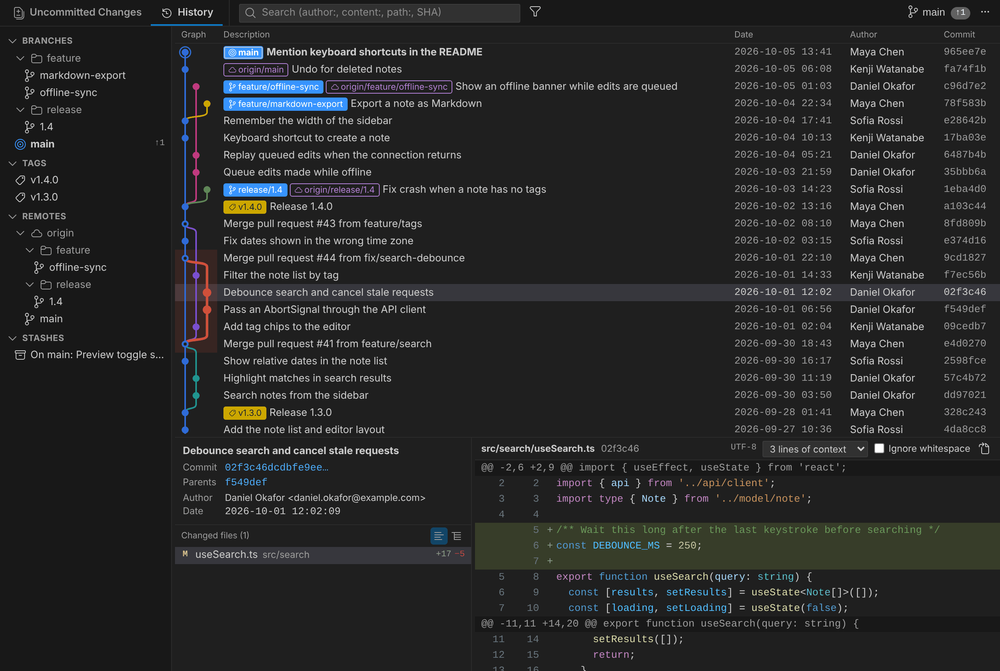

# Twigline

[English](./README.md)

コミットグラフ、ブランチの一覧、行単位でステージできるファイルステータスと差分を 1 つのエディタタブで扱う Git クライアントです。GitHub ・ GitLab ・ Bitbucket Cloud のプルリクエストをブランチごとに表示します。



こんな方に向いています:

- 単体の Git クライアントのようにグラフ ・ ブランチ ・ ステージ ・ 差分をまとめて使いたいが、VS Code や Cursor から離れたくない
- チームで GitHub（GitHub Enterprise Server を含む）・ Bitbucket Cloud のプルリクエストや GitLab のマージリクエストを使っていて、どのブランチにプルリクエストがあるかを見たい
- ファイルの一部をハンクや行の単位でステージする
- 操作した後で取り消すより、実行前に結果（コンフリクト、強制プッシュ、失われるコミット）を確かめたい
- 日本語の UI で使いたい、または Shift_JIS ・ EUC-JP のファイルを扱う

## 特長

- **1 つのリポジトリを 1 つのエディタタブに。** 「未コミットの変更 ｜ 履歴」のタブ、履歴グラフとブランチ ・ タグ ・ リモートブランチ ・ スタッシュの一覧、詳細 ／ 差分をまとめて表示します。
  操作は働く範囲ごとに置いています: 現在のブランチへのプル ・ プッシュ ・ マージ ・ リベースはタブの行のブランチ名（未送信 ・ 未取得の件数を押してもプッシュ ・ プル）、スタッシュ ・ 破棄は「未コミットの変更」タブの中、フェッチ ・ まとめてプッシュ ・ ブランチ ・ タグ ・ ターミナル ・ 設定はタブの行の右端の「…」。
- **ブランチのプルリクエストを表示。** GitHub（GitHub Enterprise Server を含む）・ Bitbucket Cloud にプルリクエスト、GitLab にマージリクエストがあるブランチに、状態（オープン ・ ドラフト ・ マージ済み ・ クローズ）で色分けした `#12`（GitLab は `!12`）のバッジを付けます。ブランチ ・ リモートブランチの一覧、履歴グラフ、タブの行、ブランチの削除ダイアログに表示し、クリックでプルリクエストを開きます。リモートブランチを削除した後もマージ済みのプルリクエストは表示するので、用の済んだローカルブランチがわかります。公開リポジトリはサインイン不要です。
- **ファイル ・ ハンク ・ 行単位のステージ。** 「未コミットの変更」タブで、ステージ ／ アンステージ ／ 破棄をマウスか、選択行での `Space` で。
- **履歴の書き換えもダイアログで。** インタラクティブリベース（ドラッグで並べ替え、pick ・ reword ・ edit ・ squash ・ fixup ・ drop）、チェリーピック、打ち消し、リセット、直前のコミットの修正。途中で止まったリベース ・ マージ ・ チェリーピック ・ 打ち消しは、続行 ・ 中止のボタン付きのバナーで表示します。
- **実行前に結果を表示。** プッシュ ・ プル ・ マージ ・ リベース ・ リセット ・ ブランチの削除は、何が起きるかを示すダイアログを開きます: リモートブランチに対する未送信 ・ 未取得の件数、予想されるコンフリクト、強制プッシュの要否、リベースで書き換わるプッシュ済みのコミット、どのブランチ ・ タグ ・ リモートブランチからもたどれなくなるコミット。強制はチェックを入れるまでオフのままです。オプション付きの操作は、実行する git コマンドもプレビューします。
- **すべてのリポジトリを一覧で。** アクティビティバーに、リポジトリごとのブランチ、変更されたファイルの数、止まっている操作やコンフリクトを表示し、行ごとにフェッチ ／ プル ／ プッシュできます。ワークスペースの外のリポジトリも開けます。
- **VS Code の一部として。** 右クリックは VS Code のコンテキストメニュー、色は現在の配色テーマに合わせ、差分は VS Code に入っている言語の文法で構文ハイライト。リストと差分はキーボードで操作できます。
- **日本語と英語。** 両方の言語の UI。日本語のファイル名と、Shift_JIS ・ EUC-JP のファイルの差分。
- **無料のオープンソース**（MIT）。アカウント不要、テレメトリなし。git 自身の通信のほかに Twigline が接続するのは、プルリクエストを読むための GitHub ・ GitLab ・ Bitbucket だけで、これはオフにもできます。

含まないもの: エディタ上の blame 表示、Azure DevOps ・ Bitbucket Data Center のプルリクエスト（「プルリクエストを作成」でそのページを開くだけ）、VS Code の中でのプルリクエストのレビュー。
Twigline は VS Code のソース管理ビューと併用するもので、置き換えるものではありません。

## インストール

- VS Code: 拡張機能ビューで「Twigline」を検索（VS Code Marketplace）
- Cursor などの VS Code 互換エディタ: 拡張機能ビューで「Twigline」を検索（Open VSX Registry）

## 必要なもの

- VS Code 1.95 以降、または VS Code 1.95 以降をベースにした Cursor
- Git（VS Code の組み込みの Git 拡張機能が使う git を使います。別の git を使うときは設定の `twigline.gitPath` に指定します）
- 信頼されたワークスペース（制限モードと仮想ワークスペースでは動きません）

## 使い方

| 入口 | 操作 |
| --- | --- |
| コマンドパレット | `Twigline: Twigline でリポジトリを開く`（`twigline.open`） |
| ソース管理ビューのタイトル | Twigline のアイコン |
| アクティビティバー | 「Twigline」→ リポジトリ一覧 |
| ステータスバー | `main ↑1 ↓2` をクリック |
| エクスプローラー ・ エディタタブの右クリック | 「ファイル履歴」 |

パネル内のキー: `Ctrl+Shift+1 / 2`（未コミットの変更 ／ 履歴）、`Ctrl+F`（履歴の検索）、`Ctrl+Shift+R`（再読み込み）、`Ctrl+Enter`（コミット）、
リストの `↑ ↓ PageUp PageDown Home End`、ファイル一覧 ・ 差分の選択行で `Space`（ステージの切り替え）、`Shift+F10`（右クリックメニュー）。
フェッチ ／ プル ／ プッシュはコマンドとして公開しているので、キーはお好みで割り当ててください。

アクティビティバーのリポジトリ一覧には、ブランチ、変更されたファイルの数（バッジ）、途中で止まっているリベース ・ マージ ・ チェリーピック ・ 打ち消しを表示します（黄色。競合があるときは赤で `!`）。
行にポインターを合わせるとフェッチ ／ プル ／ プッシュ、右クリックで統合ターミナルで開く ・ パスのコピーも使えます。タイトルの歯車で Twigline の設定を開きます。
「統合ターミナルで開く」（ここと、パネルの「…」）は、そのリポジトリで開いているターミナルがあれば新しく開かずにそれを表示します。Windows では、Git for Windows が入っていて VS Code で既定のターミナルのプロファイルを選んでいなければ Git Bash で開きます。シェルを選ぶときは、設定の `twigline.terminal.profile` にプロファイルの名前を指定します（`default` なら VS Code の既定のプロファイル）。

ワークスペースの外のリポジトリは「フォルダーからリポジトリを開く…」（一覧のタイトルのフォルダーのアイコン、またはコマンドパレット）で開きます。
ワークスペースの信頼の対象外なので、初めて開くときは git を実行する前に、リポジトリのルートを示して確認します（選んだフォルダーがもっと大きなリポジトリの中にあることもあるため。git はリポジトリに設定されたプログラムを実行することがあります。フック、`core.fsmonitor` など）。
信頼するのはそのリポジトリだけで、その中にある別のリポジトリは改めて確認します。
開いたリポジトリは一覧の末尾の「その他のリポジトリ」に、同じマシンのどのウィンドウでも表示します（リモートのウィンドウでは、ホスト ・ WSL のディストリビューション ・ コンテナーごとの一覧）。右クリックの「一覧から外す」で外します。すでに開いているウィンドウには、一覧が更新されたときに表示されます。
ブランチとバッジはパネルを開いている間だけ表示し、開くまでは git を実行しません。信頼の対象でなくなったリポジトリのパネルは、VS Code の起動時に開き直しません。
ファイルの変更は vscode.git から届かないので、ウィンドウにフォーカスが戻ったとき、パネルを表示したとき、VS Code でその中のファイルを保存（作成 ・ 削除 ・ 名前の変更）したとき、パネルが見えていてウィンドウにフォーカスがある間は数秒ごとに、`git status` を読み直します。

パネルを開いたとき、未コミットの変更があれば「未コミットの変更」タブ、なければ「履歴」タブを出します。
履歴の検索欄は 1 つで、接頭辞で検索の種類を選びます。

| 入力 | 動き |
| --- | --- |
| `ログイン` | メッセージを検索 |
| `author:鈴木` | 作成者で検索 |
| `content:validate(` | 変更内容で検索（`git log -G`） |
| `path:src/auth` | そのパスの履歴（グラフ付き） |
| `a1c93e0`（7 文字以上の 16 進数）・ `sha:feature/login` | そのコミットへ移動 |

表示するブランチ ・ リモートブランチ ・ スタッシュは検索欄の横の絞り込みボタンで切り替えます。並び順は設定（`twigline.history.order`）で変えます。

ファイル履歴には「名前変更を追う」の切り替えがあります。オンなら名前を変える前の履歴までさかのぼり、コミットを点だけで描きます。オフならグラフの線を描きます。

## プルリクエスト

リモートが GitHub（GitHub Enterprise Server を含む）、GitLab（gitlab.com、またはホスト名が `gitlab.` で始まる自社サーバー）、Bitbucket Cloud（bitbucket.org）なら、
ブランチに紐づくプルリクエストを `#12`（GitLab のマージリクエストは `!12`）の印で出します
（ブランチ ・ リモートブランチの一覧、履歴と詳細のブランチのバッジ、タブの行の現在のブランチ、ブランチの削除のダイアログの一覧）。
印を押すか、ブランチの右クリックの「プルリクエストを開く」でブラウザに開きます。レビュー中の PR があるブランチには「プルリクエストを作成」を出しません。

| 印 | 状態 |
| --- | --- |
| 緑 ・ `git-pull-request` | レビュー中 |
| 灰 ・ `git-pull-request-draft` | 下書き |
| 紫 ・ `git-merge` | マージ済み（ブランチ名を薄く出す） |
| 赤 ・ `git-pull-request-closed` | マージせずにクローズ（Bitbucket の却下 ・ 別の PR への置き換えを含む。ブランチ名を薄く出す） |

- ローカルブランチは追跡先のブランチ名で探します（追跡先がリモートで消えていても、マージ済みの PR を出します）。
  同じブランチ名の PR が複数あれば、レビュー中のものを優先し、なければ最後に更新されたものを出します。フォークからの PR はリモートの持ち主で区別します。
- 公開リポジトリはサインインなしで読みます（最近更新された PR から探す。GitHub は 100 件、Bitbucket は 50 件。どちらも 1 時間 60 回まで）。
  GitLab は、トークンの有無にかかわらず、最近更新された 100 件とローカルブランチの名前を指定したマージリクエストを 1 回で読みます。
- 非公開の GitHub リポジトリは、ブランチの一覧の末尾の「GitHub にサインインして PR を表示」から VS Code の GitHub アカウントでサインインします（範囲は `repo`）。
  サインインすると、ローカルブランチは名前を指定して古い PR も探します。GitHub Enterprise Server は `github-enterprise.uri` にサーバーの URL を設定します。
- 非公開の Bitbucket リポジトリは、「Bitbucket に接続して PR を表示」から Atlassian アカウントのメールアドレスと API トークン（範囲は `read:pullrequest:bitbucket`）を入力します。
  VS Code のシークレットストレージに保存し、ローカルブランチは名前を指定して古い PR も探します。
  保存した API トークンはコマンド `Twigline: Bitbucket の接続を解除` で削除します。Bitbucket Data Center（自社サーバー）には対応していません。
- 非公開の GitLab プロジェクトは、「GitLab に接続して MR を表示」からそのサーバーの個人用アクセストークン（範囲は `read_api`）を入力します。
  サーバーごとに VS Code のシークレットストレージに保存し、コマンド `Twigline: GitLab の接続を解除` で削除します。
  別の名前の自社サーバーや、`~/.ssh/config` のホストの別名で接続しているリモートは見分けられません。
- 読んだ結果はしばらく使い回し（サインインありは 30 秒、なしは 2 分）、フェッチ ・ プッシュのあと、パネルに戻ったとき、表示中は 3 分おきに読み直します。
  `Ctrl+Shift+R`（再読み込み）ではすぐに読み直します。
- 表示しないときは設定の `twigline.pullRequests.enabled` をオフにします（GitHub ・ GitLab ・ Bitbucket へ問い合わせなくなります）。

## コミットメッセージのリンク

コミットの詳細では、メッセージ中の URL がリンクになり、ブラウザで開きます。
課題 ・ プルリクエストへの参照は、どこを指すかを設定するとリンクになります:

設定はパネルの「…」の「コミットメッセージのリンク…」で行います（コミットメッセージにポインターを合わせると出るリンクのボタン、リポジトリ設定、コマンドパレットからも開けます）。
Jira などの種類を選んで URL を入力し、プロジェクトのキーは最近のコミットに使われているものから選びます。
最近のコミットと選択中のコミットで何がリンクになるかを確かめてから、このワークスペースのフォルダー（`.vscode/settings.json`）かユーザー設定に保存します。

- **課題管理システム**（`twigline.issueLinks.trackers`）: Jira ・ Backlog ・ Redmine ・ YouTrack ・ Linear ・ Azure Boards（GitHub から使う `AB#123`）・ 別の GitHub リポジトリの課題、または独自の正規表現。
  `UTF-8` のような文字列を課題と取り違えないよう、プロジェクトのキー（`PROJ-123` の `PROJ`）を指定します。

  ```json
  "twigline.issueLinks.trackers": [
    { "type": "jira", "url": "https://example.atlassian.net", "keys": ["PROJ", "UI"] },
    { "type": "custom", "pattern": "wiki:(\\S+)", "url": "https://wiki.example.com/$1" }
  ]
  ```

- **リモートのホスティングサービスの書き方の参照**（`twigline.issueLinks.builtIn`）。課題を別の場所で管理しているプロジェクトでは `#123` が的外れなリンクになるため、既定はオフです。
  リモートは `upstream`、`origin` の順に使います。課題管理システムを先に試します。

| サービス | リンクになるもの |
| --- | --- |
| GitHub（GitHub Enterprise Server を含む） | `#123`・`GH-123`・`owner/repo#123`（課題。PR の番号なら GitHub が PR に転送します）、「Merge pull request #123」の PR |
| GitLab | `#123`（課題）、`!123`（マージリクエスト）、`group/project#123`・`group/project!123` |
| Bitbucket Cloud | `#123`（課題）、「pull request #123」（PR。Bitbucket のマージコミットの書き方） |
| Azure DevOps | `#123`（作業項目）、`!123`・「Merged PR 123」（PR） |

- 設定はリポジトリごとに読むので、マルチルートのワークスペースではフォルダーごとに設定できます（`.vscode/settings.json`）。
- サービスはリモート URL のホスト名で見分けます（`github.com` と `github.*`、`gitlab.com` と `gitlab.*`、`bitbucket.org`、`dev.azure.com`）。
  別の名前の自社サーバーや、`~/.ssh/config` のホストの別名を使うときは、代わりに課題管理システムを追加してください。
- 開くのは `http` と `https` の URL で、そのコミットのメッセージに Twigline が改めて見つけたリンクだけです。リンクを作るためにサービスへ問い合わせることはありません。

## 開発に参加する

ビルド、テスト、リリースの手順は [CONTRIBUTING.md](./CONTRIBUTING.md)（英語）にあります。

## ライセンス

[MIT](./LICENSE)
