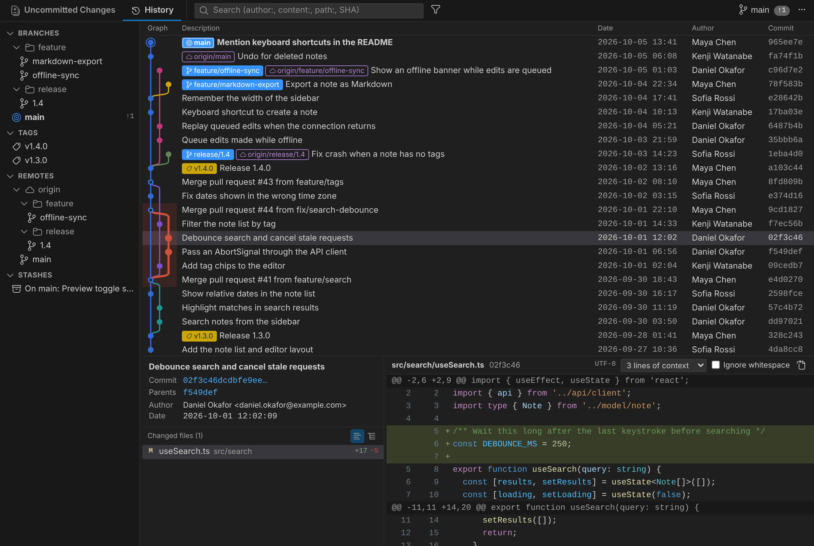

# Twigline

A Git client with the commit graph, branches, line-level staging and diffs in one editor tab, and pull request badges from GitHub and Bitbucket Cloud on each branch.

[日本語](./README.ja.md)



Twigline may suit you if:

- you want the graph, branches, staging and diffs of a standalone Git client together, without leaving VS Code or Cursor
- your team opens pull requests on GitHub (including GitHub Enterprise Server) or Bitbucket Cloud, and you want to see which branches have one
- you stage parts of a file by hunk or line
- you would rather see what an operation will do (conflicts, a force push, commits that would be lost) before running it than undo it afterwards
- you work in Japanese, or with Shift_JIS / EUC-JP files

## Features

- **One repository, one editor tab.** "Uncommitted Changes | History" tabs, the history graph with lists of branches, tags, remote branches and stashes, and details / diffs side by side.
  Actions sit where they apply: pull, push, merge and rebase for the current branch on the branch name in the tab row (clicking the ahead / behind counts also pushes / pulls); stash and discard inside the "Uncommitted Changes" tab; fetch, push branches, branch, tag, terminal and settings under "…" at the right end of the tab row.
- **Pull requests on your branches.** Branches with a pull request on GitHub (including GitHub Enterprise Server) or Bitbucket Cloud get a `#12` badge colored by its state (open, draft, merged, closed), in the branch and remote branch lists, the history graph, the tab row and the Delete Branch dialog; click it to open the pull request. Merged pull requests are still shown after the remote branch is deleted, so you can tell which local branches are done with. Public repositories need no sign-in.
- **Stage by file, hunk or line.** Stage, unstage or discard in the "Uncommitted Changes" tab, with the mouse or `Space` on the selected row.
- **Rewrite history in dialogs.** Interactive rebase (reorder by dragging; pick, reword, edit, squash, fixup, drop), cherry-pick, revert, reset, amend; a rebase, merge, cherry-pick or revert that stops is shown in a banner with Continue and Abort.
- **See the result before it runs.** Push, pull, merge, rebase, reset and branch deletion open a dialog that says what will happen: ahead / behind against the remote branch, predicted conflicts, whether a force push is needed, pushed commits a rebase would rewrite, and commits no branch, tag or remote branch would still have. Force stays off until you check it. Every action with options also previews the git command it will run.
- **All your repositories at a glance.** The Activity Bar lists each repository's branch, number of changed files, and any operation that has stopped or has conflicts, with fetch / pull / push per row. Repositories outside the workspace can be opened too.
- **Part of VS Code.** Right-click opens VS Code's own context menu; colors follow the current color theme; diffs are syntax-highlighted with the grammars installed in VS Code; lists and diffs work from the keyboard.
- **English and Japanese.** The UI in both languages; Japanese file names and Shift_JIS / EUC-JP files in diffs.
- **Free and open source** (MIT), with no account and no telemetry. Besides what git itself does, Twigline connects only to GitHub and Bitbucket to read pull requests, and that can be turned off.

Not included: blame annotations in the editor, pull requests on GitLab, Azure DevOps or Bitbucket Data Center (only "Create Pull Request" opens their pages), and reviewing pull requests inside VS Code.
Twigline works alongside VS Code's Source Control view and does not replace it.

## Installation

- VS Code: search for "Twigline" in the Extensions view (VS Code Marketplace)
- Cursor and other VS Code-compatible editors: search for "Twigline" in the Extensions view (Open VSX Registry)

## Requirements

- VS Code 1.95 or later, or Cursor based on VS Code 1.95 or later
- Git (Twigline uses the git that VS Code's built-in Git extension uses; set `twigline.gitPath` to use a different one)
- A trusted workspace (Twigline does not run in Restricted Mode or in virtual workspaces)

## Usage

| Where | How |
| --- | --- |
| Command Palette | `Twigline: Open Repository in Twigline` (`twigline.open`) |
| Source Control view title | The Twigline icon |
| Activity Bar | "Twigline" → Repositories |
| Status Bar | Click `main ↑1 ↓2` |
| Right-click in the Explorer or on an editor tab | "File History" |

Keys in the panel: `Ctrl+Shift+1 / 2` (Uncommitted Changes / History), `Ctrl+F` (search history), `Ctrl+Shift+R` (refresh), `Ctrl+Enter` (commit),
`↑ ↓ PageUp PageDown Home End` in lists, `Space` on the selected row of the file list or diff (toggle staging), `Shift+F10` (context menu).
Fetch / pull / push are available as commands, so you can bind them to keys of your choice.

The repository list in the Activity Bar shows each repository's branch, the number of changed files (badge), and a rebase, merge, cherry-pick or revert that has stopped (yellow; red with `!` when there are conflicts).
Hovering a row shows fetch / pull / push; right-click also offers opening it in the integrated terminal and copying its path. The gear in the title opens Twigline's settings.
"Open in Integrated Terminal" (here or under "…" in the panel) shows a terminal already open in the repository instead of opening another. On Windows it opens Git Bash when Git for Windows is installed and no default terminal profile is chosen in VS Code. To choose the shell, set `twigline.terminal.profile` to a profile's name, or to `default` for VS Code's default profile.

A repository outside the workspace can be opened with "Open Repository from Folder…" (the folder icon in the title of the list, or the Command Palette).
Workspace Trust does not cover it, so Twigline asks before running git there the first time, naming the repository's root (the chosen folder may be inside a larger repository): git can run programs set in the repository (hooks, `core.fsmonitor` and others).
Only that repository is trusted; a repository inside it is asked about separately.
It is then listed under "Other Repositories" at the end of the list, in every window of the same machine (a remote window keeps its own list per host, WSL distribution or container), until "Remove from List" in its right-click menu. A window that is already open shows a repository added in another window after its list is refreshed.
Its branch and badges are shown while its panel is open; Twigline does not run git in it until it is opened. A panel of a repository that is no longer trusted is not reopened when VS Code starts.
vscode.git does not report changes to its files, so Twigline reads `git status` again when the window gets focus, when the panel is shown, when a file in it is saved (or created, deleted, renamed) in VS Code, and every few seconds while the panel is visible and the window has focus.

When the panel opens, it shows the "Uncommitted Changes" tab if there are uncommitted changes, and the "History" tab otherwise.
History has a single search box; a prefix selects the kind of search.

| Input | Result |
| --- | --- |
| `login` | Search commit messages |
| `author:alice` | Search by author |
| `content:validate(` | Search changes (`git log -G`) |
| `path:src/auth` | History of that path (with the graph) |
| `a1c93e0` (7 or more hex digits) / `sha:feature/login` | Go to that commit |

The filter button next to the search box chooses which branches, remote branches and stashes to show. The order is set with `twigline.history.order`.

File history has a "Follow renames" toggle. When on, history continues past renames and commits are drawn as dots only; when off, the graph lines are drawn.

## Pull requests

If the remote is on GitHub (including GitHub Enterprise Server) or Bitbucket Cloud (bitbucket.org), pull requests for branches are shown with a `#12` badge
(in the branch and remote branch lists, on branch badges in history and details, on the current branch in the tab row, and in the list of the Delete Branch dialog).
Click the badge, or "Open Pull Request" in a branch's context menu, to open it in the browser. "Create Pull Request" is not offered for branches with an open pull request.

| Badge | State |
| --- | --- |
| Green / `git-pull-request` | Open |
| Gray / `git-pull-request-draft` | Draft |
| Purple / `git-merge` | Merged (branch name dimmed) |
| Red / `git-pull-request-closed` | Closed without merging (including declined or superseded on Bitbucket; branch name dimmed) |

- Local branches are matched by the name of their upstream branch (merged pull requests are still shown after the upstream branch is deleted on the remote).
  If several pull requests share a branch name, an open one wins, otherwise the most recently updated one. Pull requests from forks are told apart by the remote's owner.
- Public repositories are read without signing in (from the most recently updated pull requests: 100 on GitHub, 50 on Bitbucket; both limited to 60 requests per hour).
- For a private GitHub repository, click "Sign in to GitHub to show pull requests" at the end of the branch list and sign in with your GitHub account in VS Code (scope `repo`).
  Once signed in, older pull requests of local branches are also found by name. For GitHub Enterprise Server, set `github-enterprise.uri` to the server URL.
- For a private Bitbucket repository, click "Connect to Bitbucket to show pull requests" and enter your Atlassian account email and an API token (scope `read:pullrequest:bitbucket`).
  The token is stored in VS Code's secret storage, and older pull requests of local branches are also found by name.
  Remove the saved token with the command `Twigline: Disconnect from Bitbucket (Remove Saved API Token)`. Bitbucket Data Center (self-hosted) is not supported.
- Results are reused for a while (30 seconds when signed in, 2 minutes otherwise) and re-read after fetch / push, when you return to the panel, and every 3 minutes while it is visible.
  `Ctrl+Shift+R` (refresh) re-reads them immediately.
- To turn this off, disable `twigline.pullRequests.enabled` (Twigline then stops querying GitHub and Bitbucket).

## Links in commit messages

In the commit details, URLs and references to issues and pull requests in the message are links that open in the browser.
References follow the conventions of the hosting service of the remote (`upstream` first, then `origin`):

| Service | Links |
| --- | --- |
| GitHub (including GitHub Enterprise Server) | `#123`, `GH-123` and `owner/repo#123` (issues; GitHub forwards a pull request number), the pull request of "Merge pull request #123" |
| GitLab | `#123` (issues), `!123` (merge requests), `group/project#123` and `group/project!123` |
| Bitbucket Cloud | `#123` (issues), "pull request #123" (pull requests, as in Bitbucket's merge commits) |
| Azure DevOps | `#123` (work items), `!123` and "Merged PR 123" (pull requests) |

- Other trackers, such as Jira, Backlog or Redmine, are added with `twigline.issueLinks.rules`: a regular expression and a URL in which `$0` (the whole match) and `$1`–`$9` (groups) are replaced.
  These are tried before the built-in references; turn those off with `twigline.issueLinks.builtIn`.

  ```json
  "twigline.issueLinks.rules": [
    { "pattern": "\\b([A-Z][A-Z0-9_]+-[0-9]+)\\b", "url": "https://example.atlassian.net/browse/$1" }
  ]
  ```

- The service is told from the host name of the remote URL (`github.com` and `github.*`, `gitlab.com` and `gitlab.*`, `bitbucket.org`, `dev.azure.com`).
  For a self-hosted server with another name, or a host alias from `~/.ssh/config`, add a rule.
- Only `http` and `https` URLs are opened, and only links Twigline finds again in the commit's message. Nothing is read from the service to make the links.

## Contributing

See [CONTRIBUTING.md](./CONTRIBUTING.md) for how to build, test and release.

## License

[MIT](./LICENSE)
